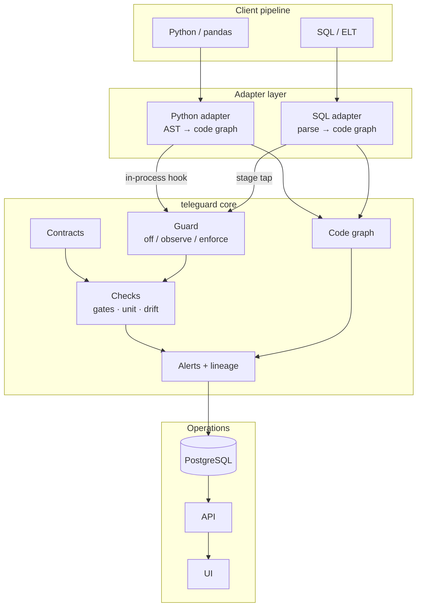

# Architecture: Telemetry Pipeline Hardening

> System design for Driftline: attach quality and drift monitoring beside a client telemetry pipeline without owning its scheduler or destination.

---

## 1. Core idea

Only a thin **adapter** knows how a given pipeline is written. The core works on **data at checkpoints** and a **shared code-graph model**.



### Attach modes

| Mode | Mechanism | Pipeline change |
|---|---|---|
| **In-process hook** | `df = guard.check(checkpoint, df, ctx)` at stage boundaries | Few declared lines |
| **Out-of-process tap** | Read stage output (table/file) after the stage writes it | None |

Both call the same `Guard`, so checks and alerts are identical either way.

---

## 2. Components

| Component | Role |
|---|---|
| **Adapters** | Build code graph + propose findings (guarantees) from source |
| **Code graph** | Stages, fields, dataflow, evidence; lineage queries |
| **Contracts** | Which checks run at which checkpoint |
| **Guard** | Runs checks at a checkpoint; never mutates client data |
| **Checks** | Schema, nulls, range, volume, unit, numeric drift, text drift |
| **Baselines** | Frozen “normal” profiles for drift / unit / segment volume |
| **Alerts** | Deduped issues with field, segment, severity, lineage |
| **Sinks** | Persist results (memory for tests; Postgres for durable ops) |
| **API / UI** | Register decisions, inspect graph, view runs and alerts |
| **Evaluate** *(optional lab)* | Fault injection + precision / recall / lag against ground truth |

---

## 3. Runtime contracts

### Guard
```text
guard.check(checkpoint, df, ctx) -> df
```

| Mode | Behaviour |
|---|---|
| `off` | No checks; return the same object |
| `observe` | Check a copy; record results; return original (fail-open) |
| `enforce` | Observe, then apply fail policy on `FAIL` |

### Guarantees → checks
1. Adapter proposes **findings** from static analysis.  
2. Human **confirms or rejects** each finding.  
3. Confirmed findings select which rules from the **contract** are active.  
4. `build_checks` produces runnable checks for each checkpoint.  
5. Guard executes those checks on each batch.

### Code graph
- **Nodes:** module, function, field, output, external, stage  
- **Edges:** imports, calls, reads, writes, derives, produces, next_stage  
- Each edge carries **evidence** (location + snippet) and **origin** (static / runtime / both)  
- **Lineage:** downstream / upstream over data edges for alert blast radius  

### Results
- **CheckResult:** check name, type, checkpoint, status, field, segment, message, details  
- **Alert:** id, pipeline, batch, severity, message, root field, segment, lineage, affected outputs  

---

## 4. Data flow (production)

```text
Register pipeline source
        → code graph + proposed findings
        → human confirm/reject → contract + baselines
Client job runs (their schedule)
        → hook or tap at each checkpoint
        → Guard (observe or enforce)
        → check results + alerts → store
        → API / UI (+ notify channels)
```

The product does not replace the client’s source, schedule, or sink. It only observes (or optionally blocks) at agreed checkpoints.

---

## 5. Storage

Durable state is keyed by **pipeline id** (see `db/migrations/`).

| Concern | Stored |
|---|---|
| Registry | Pipeline identity, freeze checksums, config (hooks + contracts) |
| Understanding | Code-graph nodes/edges, guarantees and decisions |
| Monitoring | Runs, check results, baselines, drift detections, alerts |
| Lineage | Field → output paths for blast radius |

Raw client event lakes stay in the client’s systems; we store monitoring metadata and outcomes.

---

## 6. Control and safety

- Monitoring starts in **observe** (fail-open): a broken check must not take down the client job.  
- **Enforce** is optional and policy-driven (block vs quarantine).  
- Instant rollback: set guard mode to **off**.  
- Client pipeline source under test is treated as **read-only** to the product; attach points are declared, not invented by rewriting their code.  
- Checks are **deterministic** — no LLM in pass/fail.

---

## 7. Technology

Python · pandas · pydantic · networkx · sqlglot · numpy / scipy · PyYAML · PostgreSQL · FastAPI · React (Vite) · pytest · ruff · mypy · Docker Compose · CI
